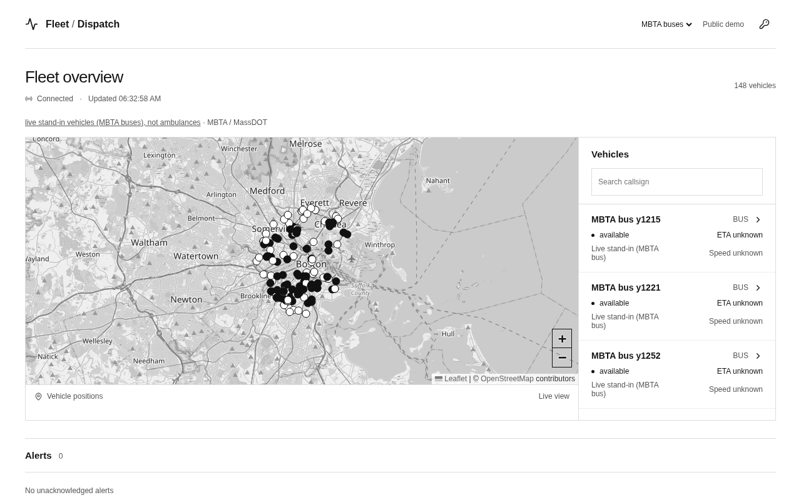
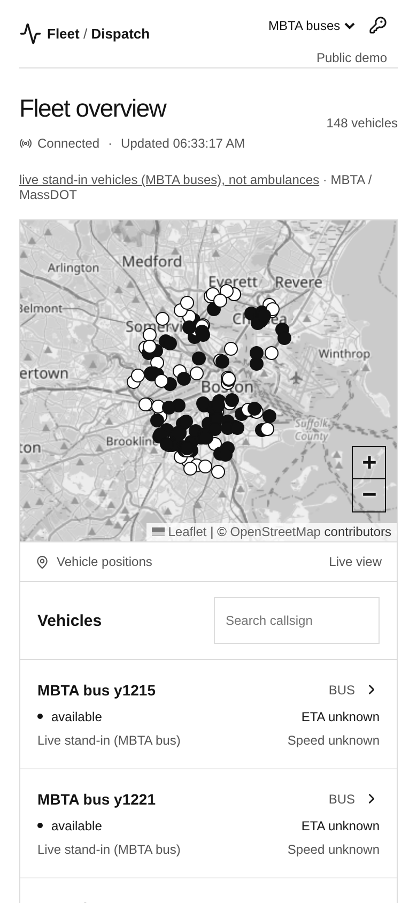
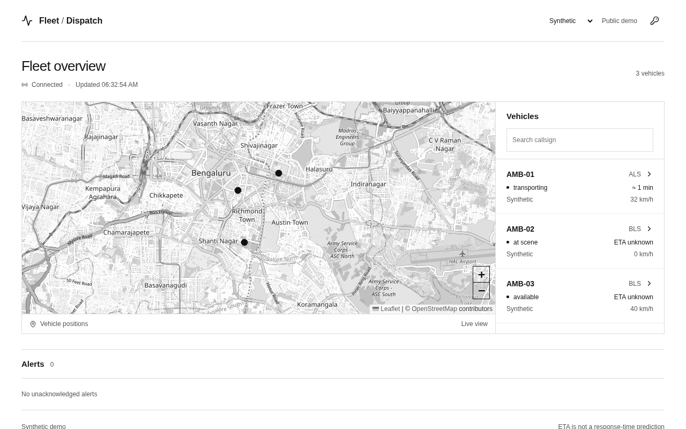
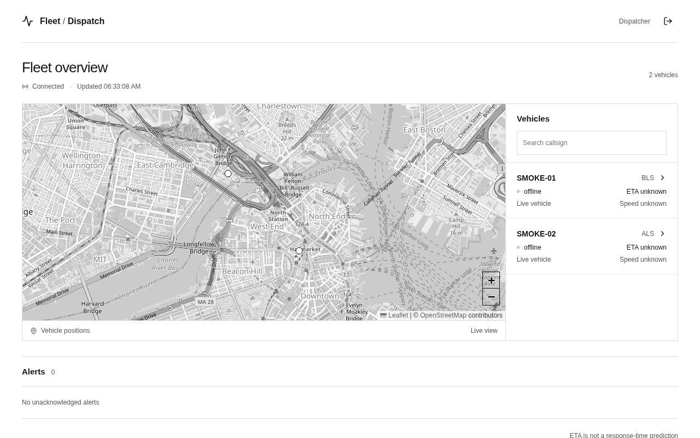

# Siren

A small live dispatch board for ambulance fleets. Vehicles post their position, the server keeps a fleet-scoped history, and a dispatcher sees them on a map in real time.

**Live demo: https://siren.flcrom.dev**

This is a prototype. It is not an emergency-dispatch or medical product, it holds no patient data, and ETAs are straight-line estimates, not response-time predictions.

<p>
  
</p>

<p>
  
  
</p>

## What you can do

- **Public demo.** Open the site. By default it shows about a hundred real Boston buses, labelled as stand-in vehicles, not ambulances. Switch the dropdown to see three synthetic ambulances in Bengaluru. Public views are read-only.
- **Dispatcher mode.** The key icon asks for a short-lived access token. Signed in, you see your own fleet, vehicle history and alerts.
- **Send positions.** Crew devices, the simulator and the Kafka bridge post pings to one authenticated endpoint.

<p>
  
</p>

## How it works

A ping is a vehicle id, a position and a timestamp. It goes through one path:

1. A crew, simulator or bridge client posts it to the Worker API with a signed token.
2. The API checks the token, the role, the vehicle it is bound to, and the payload.
3. The ping is written to the fleet's SQLite Durable Object. History is immutable. Repeated event ids are ignored.
4. The Durable Object derives status, staleness and a straight-line ETA, then pushes a snapshot over WebSocket to every connected dispatcher.

Speed and heading stay empty when the source does not report them. Nothing is guessed or filled in.

## Built and designed

The architecture diagram is at https://archi1.flcrom.dev.

| | Status |
|---|---|
| Worker API, auth, validation | Built, deployed |
| Fleet store (SQLite Durable Object) | Built, deployed |
| Dispatcher UI (React, Leaflet) | Built, deployed |
| Direct ingest: crew, simulator, MBTA feed | Built, deployed |
| Kafka bridge (reads `driver_locations`, posts to the API) | Built, tested against a mock; no broker is deployed |
| Kafka as the single entry point, producer side, rules consumer, dead-letter topic | Designed only, not built |

In the diagram, solid arrows are what runs today and dashed arrows are the target design.

## Data sources and attribution

The public demo uses real vehicle positions from the **MBTA** (Boston) as stand-ins. They are buses. They are not ambulances and the app says so wherever they appear.

- Data provided by MassDOT / MBTA under the [MassDOT Developers License Agreement](https://www.mbta.com/developers/gtfs-realtime). No MBTA or MassDOT logos are used. MassDOT does not endorse this project and does not guarantee the data.
- A Digitraffic (Finland) train feed adapter is included as a backup source. Digitraffic data is by Fintraffic / digitraffic.fi, [CC BY 4.0](https://creativecommons.org/licenses/by/4.0/).
- Map tiles and data: © [OpenStreetMap](https://www.openstreetmap.org/copyright) contributors.

## Run it locally

Node 22 or newer.

```sh
npm ci
npm run build
npm test
npx wrangler dev --port 8787
```

Open http://localhost:8787. The public demo works with no configuration.

For dispatcher mode, create `.dev.vars` (it is git-ignored) with:

```
LIVE_ENABLED=true
JWT_SECRET=<at least 32 random bytes>
```

Tokens are HS256 JWTs signed with that secret. They are minted by an operator, never by a public endpoint. Dispatcher tokens last at most one hour, crew tokens at most 15 minutes. See [`security/README.md`](security/README.md).

## Deploy

```sh
npm ci
npm run build
npx wrangler deploy
npx wrangler secret put JWT_SECRET
```

The Worker, its SQLite Durable Object and the static assets deploy together. `LIVE_ENABLED` is set in `wrangler.jsonc`. The live API stays closed until a `JWT_SECRET` exists. Custom domains are listed under `routes` in `wrangler.jsonc`. Pages are served with noindex and a strict content security policy.

## Stack

TypeScript, Cloudflare Workers, SQLite Durable Objects, React 19, Vite, Leaflet, Vitest, Playwright.

## Tests and QA

| Suite | Result |
|---|---|
| Rules and domain logic | 90 passing |
| Auth and security | 23 passing |
| Simulator and Kafka bridge | 26 passing |
| Web unit tests | 18 passing |
| Browser end-to-end (mock API) | 10 passing |
| API, store and WebSocket regression | 63 of 63 passing, run independently |

The deployed site was also checked in a real browser at desktop and phone width: map tiles load, no horizontal overflow, public views are read-only, and dispatcher sign-in works. Raw logs are in [`docs/qa`](docs/qa). The API contract is in [`docs/CONTRACT.md`](docs/CONTRACT.md).

## Limits

Per-principal rate limits are in-memory pilot safeguards, not edge protection. History pruning runs with activity and is not a deletion guarantee. Active WebSocket connections keep the Durable Object awake, which costs more than a hibernating design. Production use would need token issuance and revocation, onboarding, privacy and retention work, backups, monitoring, load tests and road-aware routing.

## Licence

No licence is attached. Until one is added, all rights are reserved.
